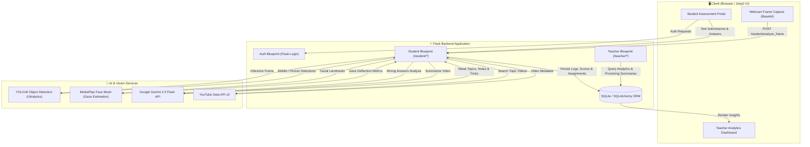

<div align="center">

# 🎓 EduSmart

### **Next-Generation AI-Powered Proctoring & Adaptive Remedial Learning Platform**

[](https://www.python.org/)
[](https://flask.palletsprojects.com/)
[](https://github.com/ultralytics/ultralytics)
[](https://ai.google.dev/)
[](https://opencv.org/)
[](https://www.sqlalchemy.org/)
[](LICENSE)

<br/>

**EduSmart** bridges the critical gap between academic integrity and personalized education. It combines **real-time computer vision proctoring (YOLOv8 + MediaPipe)** with an **autonomous LLM remedial learning engine (Google Gemini 2.5 Flash)** to ensure fair examination while transforming student mistakes into customized growth pathways.

<p align="center">
  <a href="#-key-features">Key Features</a> •
  <a href="#-system-architecture">Architecture</a> •
  <a href="#-tech-stack">Tech Stack</a> •
  <a href="#-getting-started">Getting Started</a> •
  <a href="#-project-structure">Project Structure</a> •
  <a href="#-author--acknowledgements">Author</a>
</p>

---

</div>

## 🌟 Overview

Traditional online assessment platforms face two major flaws:
1. **Integrity Vulnerabilities:** High rates of unauthorized assistance, absent candidates, or unmonitored tab-switching.
2. **Broken Feedback Loops:** Students receive a cold score without actionable, personalized remediation to master weak concepts.

**EduSmart** solves both ends of this spectrum:
- **During the Test:** Runs an intelligent, browser-streamed proctoring pipeline that detects face absence, multi-person presence, smartphones, gaze deflection, and tab-switching.
- **After the Test:** Instantly analyzes test attempt gaps, uses **Gemini 2.5 Flash** to identify granular weak topics, generates tailored revision notes and mnemonic tricks, curates relevant YouTube video tutorials, and compiles a targeted **remedial follow-up assignment**.

---

## 🚀 Key Features

### 🛡️ 1. Intelligent AI Proctoring Engine
* **Real-time Object & Person Detection:** Powered by `YOLOv8n`, running low-latency inference on streamed webcam frames to detect unauthorized devices (mobile phones) and unpermitted persons.
* **Eye Gaze & Head Orientation:** Uses `MediaPipe Face Mesh` to compute 3D facial landmark geometry and detect persistent off-screen gaze.
* **Presence & Focus Verification:** Alerts on candidate absence, multi-face presence, and browser tab/window focus losses.
* **Proctoring Audit Trail:** Generates non-intrusive on-screen warnings and logs comprehensive session metrics (`ProctoringLog`, `StressLog`, `ProctoringSummary`) for educators.

### 🧠 2. Adaptive AI Remediation (Gemini 2.5 Flash)
* **Weak Concept Extraction:** Automatically parses incorrect/unattempted test questions to diagnose exact weak learning nodes.
* **AI-Generated Revision Notes & Memory Tricks:** Produces bite-sized revision cards with mnemonics (`TopicNote`, `TopicTrick`) to aid concept retention.
* **Contextual Video Curation:** Integrates with the **YouTube Data API v3** to retrieve top-rated video lessons, paired with Gemini-generated 2-line executive summaries.
* **Personalized Follow-Up Assignments:** Automatically drafts a remedial quiz tailored specifically to the topics the student struggled with.

### 👨‍🏫 3. Comprehensive Educator Dashboard
* **Curriculum & Class Management:** Create classrooms, manage student enrollments, organize chapters, and design tests with granular scoring options.
* **Deep Analytics & Reports:** Real-time visibility into class-wide performance metrics, topic-level difficulty drop-offs, and student radar charts.
* **Proctoring Integrity Review:** View per-student proctoring alerts, timeline violations, and camera violation logs before grading or releasing scores.

### 🎓 4. Frictionless Student Experience
* **Distraction-Free Test Arena:** Sleek, accessible UI designed for optimal focus with gentle non-intrusive proctoring status prompts.
* **Interactive Post-Test Diagnostic Review:** Instant test post-mortem displaying what went wrong, why, and how to improve.
* **Remedial Assignment Workspace:** Complete targeted follow-up tasks to demonstrate mastery over previously failed concepts.

---

## 🏗️ System Architecture



---

## 🛠️ Tech Stack

| Domain | Technologies & Libraries |
| :--- | :--- |
| **Backend Framework** | Flask 3.1, Jinja2, Werkzeug, Flask-Login, Flask-WTF, Flask-Migrate |
| **Database & ORM** | SQLite, SQLAlchemy 2.0 |
| **Computer Vision** | YOLOv8 (`ultralytics`), OpenCV (`opencv-python-headless`), MediaPipe |
| **Generative AI** | Google Gemini 2.5 Flash (`google-genai`), Prompt Engineering |
| **External APIs** | YouTube Data API v3 |
| **Frontend** | HTML5, Modern CSS3, JavaScript (Fetch API, Canvas/Webcam Streaming) |

---

## 📂 Project Structure

```text
EduSmart/
├── app.py                  # Core application entry point & blueprint registration
├── models.py               # SQLAlchemy database schemas (Users, Tests, Logs, Topics, etc.)
├── extensions.py           # Shared database/migration extensions
├── requirements.txt        # Python dependency manifest
├── yolov8n.pt              # YOLOv8 pre-trained nano weights
├── instance/               # SQLite database instance
├── migrations/             # Flask-Migrate database migration scripts
├── routes/
│   ├── auth.py             # User authentication (Login, Register, Session management)
│   ├── student.py          # Student test-taking, AI proctoring & Gemini remediation
│   └── teacher.py          # Teacher classroom, test creation & analytics dashboards
├── static/
│   ├── css/                # Custom styling & responsive layouts
│   └── js/                 # Client-side scripts (camera capture, proctoring streamer)
└── templates/
    ├── base.html           # Master layout template
    ├── landing.html        # Public homepage
    ├── login.html / signup.html
    ├── student/            # Student portal templates
    │   ├── dashboard.html
    │   ├── start_test.html
    │   ├── review_test.html
    │   └── followup_assignment.html
    └── teacher/            # Teacher portal templates
        ├── dashboard.html
        ├── create_test.html
        ├── test_analytics.html
        └── student_report.html
```

---

## ⚡ Getting Started

Follow these steps to set up and run EduSmart locally.

### 1️⃣ Prerequisites
- **Python 3.10+** installed
- A modern web browser with **Webcam permissions** enabled
- A **Google Gemini API Key** ([Get one here](https://aistudio.google.com/))
- A **YouTube Data API v3 Key** ([Get one from Google Cloud Console](https://console.cloud.google.com/))

### 2️⃣ Clone the Repository
```bash
git clone https://github.com/j-pushkaraj/EduSmart.git
cd EduSmart
```

### 3️⃣ Create and Activate a Virtual Environment
```bash
# macOS / Linux
python3 -m venv venv
source venv/bin/activate

# Windows (Command Prompt / PowerShell)
# venv\Scripts\activate
```

### 4️⃣ Install Dependencies
```bash
pip install --upgrade pip
pip install -r requirements.txt
```

### 5️⃣ Configure Environment Variables
Create a `.env` file in the root directory:
```env
# Google Gemini API
GEMINI_API_KEY=your_gemini_api_key_here

# YouTube Data API
YOUTUBE_API_KEY=your_youtube_api_key_here

# Flask Secret Key
SECRET_KEY=your_super_secret_development_key
```

### 6️⃣ Run Database Migrations & Start the App
```bash
# Start the Flask development server
python app.py
```

The application will be live at:
```
👉 http://127.0.0.1:5000
```

---

## 🧪 Usage Guide

### 👨‍🏫 Teacher Flow
1. **Sign Up / Login** as an Educator.
2. **Create a Classroom** and share the class code with your students.
3. **Draft a Test:** Add questions, multiple-choice options, correct answers, and duration.
4. **Inspect Performance:** Navigate to the Analytics tab after test completion to review individual scores, class distribution, and AI Proctoring violation audit trails.

### 🎓 Student Flow
1. **Sign Up / Login** as a Student and enroll in your teacher's class.
2. **Enter the Test Arena:** Grant camera permissions for AI-assisted proctoring.
3. **Take the Test:** Answer questions while the AI ensures environment compliance.
4. **Access Personalized Diagnostic Report:**
   - View detailed score post-mortem.
   - Read AI-generated notes and tricks for topics answered incorrectly.
   - Watch recommended YouTube tutorials with Gemini AI summaries.
   - Complete the **Follow-up Assignment** to validate your understanding.

---

## 🔒 Security & Privacy Notice

- **Local Inference:** Video frames sent to `/student/analyze_frame` are processed in-memory via OpenCV/YOLO and are **not** stored permanently on disk, respecting student privacy.
- **Environment Isolation:** Sensitive API tokens are kept strictly inside `.env` configurations and never hardcoded in client scripts.

---

## 🗺️ Roadmap

- [ ] Multi-modal question types (diagram recognition & formula input)
- [ ] Audio anomaly detection (speech / background whispering detection)
- [ ] Exportable PDF analytics reports for parents and administrators
- [ ] LMS Integration via LTI (Canvas, Moodle, Google Classroom)

---

## 🤝 Contributing

Contributions make the open-source community an amazing place to learn, inspire, and create. Any contributions you make are **greatly appreciated**!

1. Fork the Project
2. Create your Feature Branch (`git checkout -b feature/AmazingFeature`)
3. Commit your Changes (`git commit -m 'Add some AmazingFeature'`)
4. Push to the Branch (`git push origin feature/AmazingFeature`)
5. Open a Pull Request

---

## 📄 License

Distributed under the **MIT License**. See `LICENSE` for more information.

---

## 👤 Author

**Pushkaraj Joshi**
- GitHub: [@j-pushkaraj](https://github.com/j-pushkaraj)
- Project Repository: [EduSmart](https://github.com/j-pushkaraj/EduSmart)

<div align="center">
  <sub>Built with ❤️ using Flask, YOLOv8, and Google Gemini</sub>
</div>
